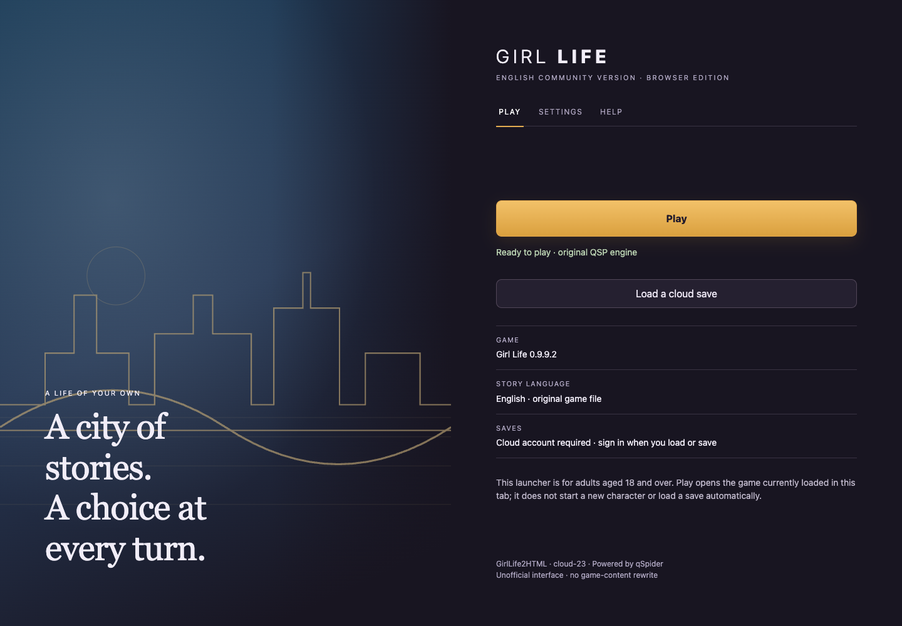
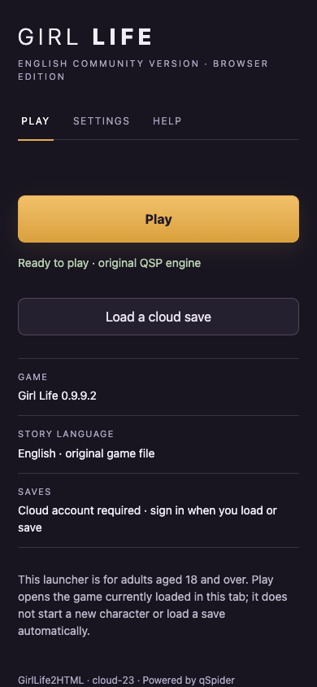
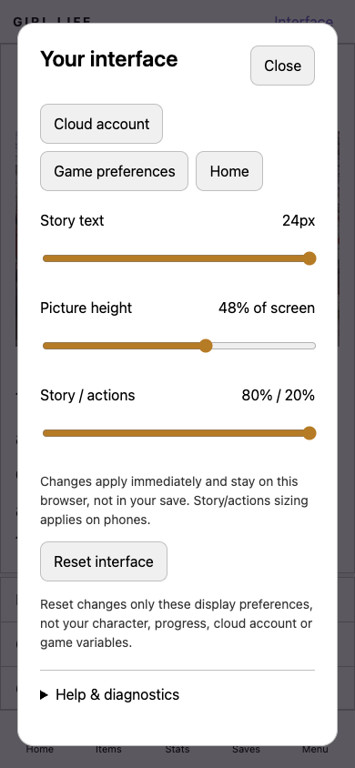
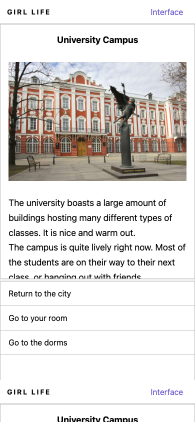
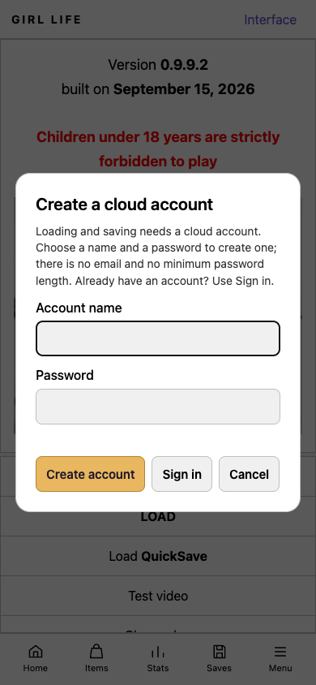
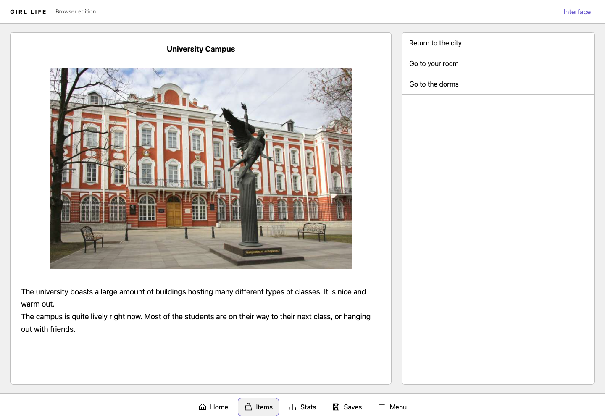
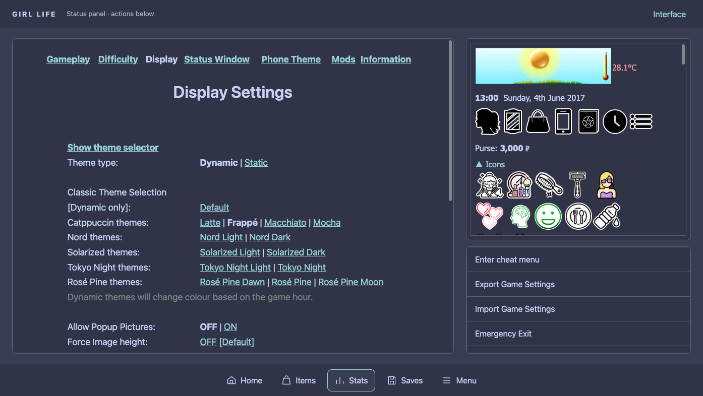

# Girl Life HTML Builder

繁體中文說明：[README.zh-TW.md](README.zh-TW.md)

Build and run a browser-playable package of the original English Girl Life QSP game using the official QSPFoundation qSpider player.

> **Builder only:** this repository does not include the game, images, sounds, or generated game package. Provide the game and assets you are authorized to use.

## Contents

- [Original game and community](#original-game-and-community)
- [Screenshots](#screenshots)
- [Requirements](#requirements)
- [Folder layout](#folder-layout)
- [Build and run](#build-and-run)
- [Browser launcher](#browser-launcher)
- [Loading and mobile interface](#loading-and-mobile-interface)
- [Validation status](#validation-status)
- [Cloud saves](#cloud-saves)
- [Server configuration](#server-configuration)
- [Asset discovery and missing files](#asset-discovery-and-missing-files)
- [Scope and limitations](#scope-and-limitations)
- [License](#license)

## Original game and community

This is an **unofficial HTML builder**, not the original Girl Life project.

- [Girl Life — English Community Version: original release page](https://tfgames.site/game/597/girl-life-english-community-version)
- [Upstream source code: Kevin Smarts / Girl Life](https://gitlab.com/kevinsmartstfg/girl-life)
- [Girl Life community wiki](https://sites.google.com/view/girllifewiki)
- Obtain matching media packs through the original release/community instructions; no game or media pack is bundled in this repository.

> Public source code and free downloads do not by themselves grant permission to translate, redistribute, or host every game asset. Confirm the relevant permissions separately; the player's license does not license the game's text or media.

## Screenshots

- **Source:** local cloud-23 test package, captured on 2026-11-01.
- **Mobile:** simulated 390×844 touch viewport, not a physical phone.
- **Account dialog:** shared registration/sign-in screen, with no credentials entered.
- **Credits:** game content belongs to its respective creators.

### Launcher and interface settings



 

### Gameplay and cloud account

 

### Desktop website



### In-game colors and right-column panels



## Requirements

- macOS or Windows 10/11
- An English `.qsp` game file
- An `images/` directory or a recognized image ZIP archive
- A `sound/` directory or, optionally, a recognized sound ZIP archive
- Internet access for the first build, to download the qSpider v1.3.1 player

### Python setup

1. The launcher checks for **Python 3.10 or newer**.
2. If missing, it asks before downloading the official installer from [python.org](https://www.python.org/downloads/).
3. Answer `y` to continue, or press Enter to cancel.
4. The installer signature is checked before opening or running it.

| Platform | Installation behavior |
| --- | --- |
| macOS | Opens the official installer UI. |
| Windows | Installs for the current user; the install command does not request administrator access. |

No third-party Python packages are required.

## Folder layout

Put the builder files beside the English `.qsp` file and its assets:

```text
GirlLife/
├── Build-GirlLife-HTML.bat
├── Build-GirlLife-HTML.ps1
├── Build-GirlLife-HTML.sh
├── build_girllife_html.py
├── girllife_server.py       # cloud-save service (hosted by the project owner)
├── Girl Life 0.9.9.2.qsp
├── images/
└── sound/                 # optional; audio is absent if not provided
```

- **Game selection:** the English `.qsp` filename must not contain `_cn`.
- **Multiple games:** the builder asks you to choose one.
- **Sound fallback:** it can use the parent directory's `sound/` folder when that is the only adjacent sound folder found.

## Build and run

### macOS

Run from Terminal:

```sh
./Build-GirlLife-HTML.sh
```

If macOS blocks the script because it is not marked executable, run:

```sh
chmod +x Build-GirlLife-HTML.sh
./Build-GirlLife-HTML.sh
```

### Windows

1. Double-click **`Build-GirlLife-HTML.bat`**.
2. The included PowerShell launcher checks Python and asks for consent before any required download/install.
3. The builder starts after the prerequisite check.

PowerShell is included with supported Windows versions. **Windows execution remains unverified.**

### What happens next

1. Creates a sibling folder named `<English game filename>_HTML`.
2. Audits assets and reports missing media.
3. Starts a local server on a dynamically assigned port.
4. Prints the URL and tries to open it in your browser.

> **Keep the launcher window open while playing.** Press `Ctrl+C` in that window to stop the server.

If a valid output folder already exists, it is preserved: the builder audits and serves it instead of overwriting it.

## Browser launcher

The original QSP engine still runs the game. The new shell changes presentation, not story or game logic.

| Control | What it does |
| --- | --- |
| Play | Opens the loaded game; use the game's Start action for a new character. |
| Load a cloud save / Saves | Opens the existing account-gated cloud-save panel. |
| Settings / Interface | Immediately adjusts story text (16–24px), picture height (24–64% of screen), and mobile story/actions split (55/45–80/20). |
| Reset interface | Restores 18px / 48% / 70–30; does not clear saves, accounts, or game variables. |
| Home | Returns to the launcher without restarting, loading, or saving. **Progress remains in this tab only; reloading still loses unsaved play.** |
| Items / Stats | Toggles mutually exclusive engine-owned panels. |
| Menu | Opens display settings, cloud account, native game preferences, and help/diagnostics. |

- Display settings stay in this browser under `girllife.browser.interface.v1`; they are not part of a cloud save.
- Desktop uses story/actions columns. Opening Items or Stats places that panel above the actions in a wider right column, without covering the choices; wider original tables can scroll.
- Mobile uses full-width stacked panes and a bottom toolbar.
- **Game colors remain authoritative:** use the game's Display settings for colors. Background/text/link colors, header and toolbar follow the active game theme and update after loading a save. Interface reset does not reset game colors.
- Diagnostic reports are displayed locally and copied only on request. No report is sent automatically; account names, tokens, and story/save contents are excluded.
- The city SVG and shell code are original. Only the design/workflow concepts were inspired by [Girl Life Launcher](https://github.com/glife-launcher/GLreleases/releases).
- See [workflow research and test instructions](docs/launcher-workflows.md) for adopted ideas and deferred features.

## Loading and mobile interface

### Loading performance

- **Download progress:** shows game/media bytes as they download, then elapsed seconds while the game is being prepared.
- **Compressed transfer:** creates a reusable `.qsp.gz` copy; supporting servers reduce the current game transfer from about **91 MB to 11 MB**. The original `.qsp` stays intact.
- **Scene media warming:** uses a bounded queue for images/videos referenced by the current scene and visible actions, rather than preloading the entire library.
- **Video limits:** warms metadata, not necessarily the entire video. Other assets load when requested.

### Mobile layout

Applies to **Classic and Aero at widths up to 900 CSS px**.

| Element | Behavior |
| --- | --- |
| Main / actions | Full-width panes; default 70% / 30% of space between header and toolbar. |
| Main text viewport | Scrollable inside the story pane; no reserved Items-button strip. |
| Items | Bottom toolbar; opens an overlay in the main-pane area. |
| Stats | Bottom toolbar; opens an overlay in the actions-pane area. |
| Side panels | Only one can be open at a time. |
| Content and actions | Independently scrollable, with touch-sized controls. |
| Creation tables | Preserve horizontal columns; scroll sideways on narrow screens. |
| Images and videos | Scale to available space. |
| Media popup | Centered on a dark backdrop; tapping outside closes only that popup. |

## Validation status

**Last deployment verification: 2026-11-01 (Asia/Taipei).** This is a recorded result, not a continuous uptime check.

| Check | Recorded result |
| --- | --- |
| Live version | **cloud-23** at `https://girllife.mewcat.me/` |
| Source | Browser shell, tests, and bilingual docs in this repository |
| Service | Restarted; `active` |
| Homepage | HTTP 200 |
| Deployed frontend files | All nine public SHA-256 hashes matched local files |

Public smoke checks also passed: launcher → Play, account-required Saves → Cancel, immediate settings → Escape, Home, and desktop columns. Production API calls were blocked in that isolated browser test; no production account or save was created.

### cloud-23 local checks

- Original QSP gameplay with inventory mounted, not just a title-screen fixture.
- Classic and Aero: **320×568, 390×844, 430×932, 768×1024, 901×700, 1440×1000** geometry and panel switching.
- Keyboard tabs, settings persistence/reset, horizontal creation tables, Home preserving the current scene, media inside/outside taps, native preferences, and Escape isolation.
- Registration, save/load, and sign-out against a **throwaway local database**, never production accounts. An earlier cloud-22 exploratory Aero run received a storage HTTP 503; the rerun passed. This UI change does not claim to fix intermittent backend storage errors.
- Real in-game Frappé selection → save → Latte selection → load restores the exact background, text and link colors, including shell chrome, in both Classic and Aero. Desktop Stats/actions do not overlap; 320/390/430px color checks also pass.
- cloud-22's fixed shell colors incorrectly hid the engine palette. cloud-23 removes those overrides; this is a presentation fix, not a save-data migration or a claim that every historical save was repaired.
- Builder syntax, generated JavaScript syntax, cache refresh, and repeat-application tests.
- Original QSP/media remain unchanged. These are browser-emulation checks, not physical-device acceptance.

> **Still unverified:** physical Android/iPhone/Safari, Windows execution, the exact Pavlovsk bedroom from the report, all inventory interactions, and full gameplay coverage.

## Cloud saves

Supports **numbered slots, named saves, and quick saves** through `girllife.mewcat.me`.

### Register and sign in

1. Open **Saves** or the title-screen **LOAD** button.
2. On a device never signed in before, **Create account** is offered first; existing users can choose **Sign in**.
3. Enter an account name and one password; **no confirmation field** is required.
4. If that name already exists, the dialog switches to sign-in mode and preserves your input.
5. Sign in on another device with the same account to access the same saves.

| Setting | Requirement |
| --- | --- |
| Account name | 3–32 ASCII letters, digits, dots, dashes, or underscores |
| Password | Non-empty; up to 1024 characters; no additional minimum length |
| Network | Required for cloud saves; the game can still be served locally |

### Remembered sessions

- Browser `localStorage` remembers the session under `girllife.cloud.session` across reloads and browser restarts.
- Server-side sessions expire after **7 days**.
- To forget the local session, choose **Cloud account → Sign out** in the pause menu.
- Sign-out clears this device's record only; the server session remains until expiry. Remember to sign out on shared computers.

### Storage, privacy, and limits

| Item | Storage / limit |
| --- | --- |
| Passwords | Salted scrypt hashes |
| Session tokens | Hashed in the database; raw token in browser `localStorage` |
| Save contents | Server SQLite database; **no application-level encryption** |
| One save | Up to **4 MB** |
| One account | Up to **512 saves** or **256 MB** total |

> Keep a separate copy of important saves. Availability depends on the hosted service.

## Server configuration

`girllife_server.py` serves the game package and `/api/...` from one process.

| Environment variable | Default / purpose |
| --- | --- |
| `GIRLLIFE_PORT` | `8081` |
| `GIRLLIFE_SAVE_DATABASE` | SQLite database path |
| `GIRLLIFE_MAX_CONCURRENT_REQUESTS` | `96`; excess work gets HTTP `503` with `Retry-After` |
| `GIRLLIFE_REQUEST_TIMEOUT` | `65` seconds; closes idle connections |

**Request and database handling:**

- HTTP/1.1 keep-alive, with bounded concurrency rather than unlimited threads.
- SQLite schema initialization once at startup, not per request.
- One reusable WAL connection per worker thread.
- Trigger-maintained `account_usage` counts/byte totals instead of scanning an account's saves for every write.

**Deployment notes:**

- A reverse proxy must enable **HTTP/1.1 upstream keep-alive** to preserve connection reuse.
- Older databases are upgraded in place on first startup, including usage-counter backfill.

## Asset discovery and missing files

- An existing `images/` folder takes precedence over image ZIP archives. If no image folder exists, a matching ZIP can be selected and safely extracted.
- A `sound/` folder is used when present. If it is absent, the builder can select a matching sound ZIP; without either source, the game runs without its audio files.
- Image update ZIPs with `image` and one of `bugfix`, `patch`, or `update` in the filename are detected in the game folder and its parent. Identical copies are deduplicated. Multiple different update archives stop the build so the wrong patch is not silently applied.
- Missing media references are skipped; the builder does not create placeholder files.
- The final report counts unique, statically recognizable paths under `images/` and `sound/`, reference occurrences, and image/video/audio categories. Paths assembled dynamically from QSP variables or strings cannot be counted by this static scan.
- ZIP extraction rejects unsafe paths, symlinks, duplicate paths, and archives exceeding the configured expanded-size limit. RAR and 7z archives are not supported.

The original `.qsp`, asset folders, and source archives are preserved. Assets are hard-linked into the output when possible and copied when hard links are unavailable. Image patches are applied to the output package only.

## Scope and limitations

- **Does:** packages the original QSP game with qSpider and reports missing media.
- **Does not:** rewrite the game or repair its internal QSP gameplay logic.
- **Missing assets:** reported and skipped; not replaced with placeholder files.
- **Testing:** browser checks do not establish full-game, physical-device, or Windows compatibility.

## License

The builder is provided without an additional license grant. qSpider is distributed under the MIT License; its license text is included in generated packages as `QSPIDER-LICENSE.txt`. See the [qSpider v1.3.1 release](https://github.com/QSPFoundation/qspider/releases/tag/v1.3.1).
