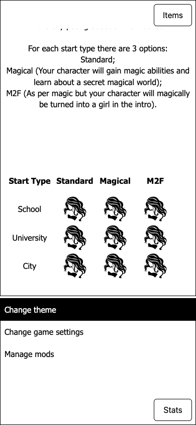
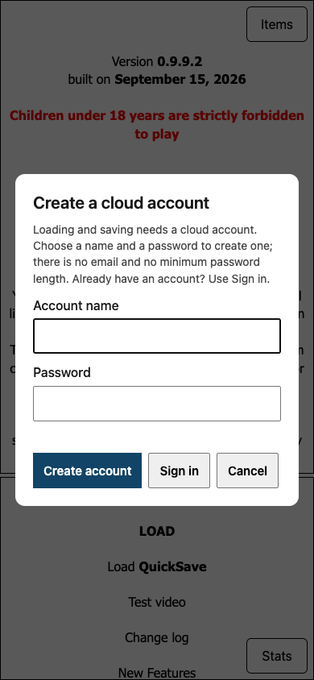
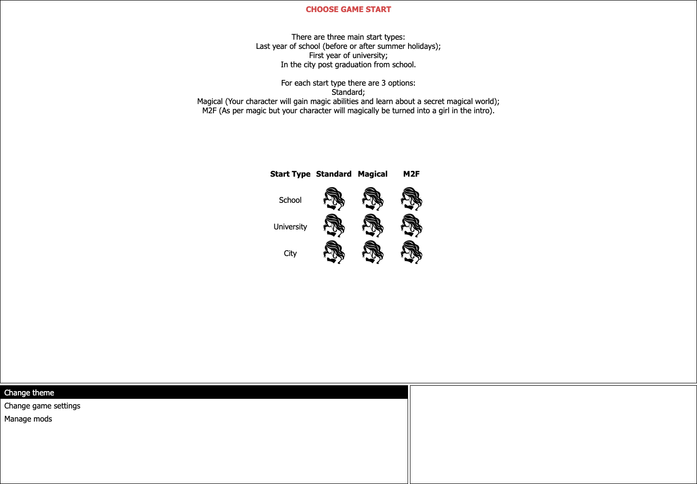

# Girl Life HTML 建置器

English documentation: [README.md](README.md)

使用官方 QSPFoundation qSpider 播放器，將原始英文版 Girl Life QSP 遊戲打包成可在瀏覽器執行的本機網站。

> **僅提供建置工具：**此 repo 不包含遊戲本體、圖片、音效或生成後的遊戲包。請自行放入你有權使用的遊戲與素材。

## 目錄

- [介面截圖](#介面截圖)
- [需求](#需求)
- [資料夾配置](#資料夾配置)
- [建置與執行](#建置與執行)
- [載入效能與手機介面](#載入效能與手機介面)
- [驗證進度](#驗證進度)
- [雲端存檔](#雲端存檔)
- [伺服器設定](#伺服器設定)
- [素材偵測與缺失檔案](#素材偵測與缺失檔案)
- [修復範圍與限制](#修復範圍與限制)
- [授權](#授權)

## 介面截圖

- **來源：**2026-11-01 的線上 cloud-21 版本。
- **手機畫面：**390×844 觸控模擬視窗，並非實體手機截圖。
- **帳號畫面：**共用的註冊／登入對話框，未輸入帳密；該張截圖隱藏了背景遊戲圖片。
- **內容權利：**遊戲內容歸原作者所有。

### 手機介面與登入／註冊介面

 

### 桌面網站介面



## 需求

- macOS 或 Windows 10/11
- 英文 `.qsp` 遊戲檔
- `images/` 資料夾或可辨識的圖片 ZIP
- `sound/` 資料夾或選用的音效 ZIP
- 首次建置需要網路，以下載 qSpider v1.3.1 播放器

### Python 準備

1. 啟動器檢查 **Python 3.10 以上版本**。
2. 若未安裝，先詢問是否從 [python.org](https://www.python.org/downloads/) 下載官方安裝程式。
3. 輸入 `y` 才繼續，直接按 Enter 則取消。
4. 下載後驗證簽章，通過才開啟或執行。

| 平台 | 安裝行為 |
| --- | --- |
| macOS | 開啟官方安裝程式介面。 |
| Windows | 只安裝到目前使用者；安裝命令不要求系統管理員權限。 |

不需要安裝第三方 Python 套件。

## 資料夾配置

將建置器檔案與英文 `.qsp`、素材放在一起：

```text
GirlLife/
├── Build-GirlLife-HTML.bat
├── Build-GirlLife-HTML.ps1
├── Build-GirlLife-HTML.sh
├── build_girllife_html.py
├── girllife_server.py       # 專案維護者部署的雲端存檔服務
├── Girl Life 0.9.9.2.qsp
├── images/
└── sound/                 # 可選；未提供時遊戲沒有音效
```

- **遊戲選擇：**只選擇檔名不含 `_cn` 的英文 `.qsp`。
- **多個遊戲檔：**會詢問要使用哪個。
- **音效備援：**遊戲資料夾沒有 `sound/` 時，若上一層只有一個相鄰的 `sound/` 資料夾，也會採用它。

## 建置與執行

### macOS

在 Terminal 執行：

```sh
./Build-GirlLife-HTML.sh
```

如果系統提示腳本沒有執行權限：

```sh
chmod +x Build-GirlLife-HTML.sh
./Build-GirlLife-HTML.sh
```

### Windows

1. 雙擊 **`Build-GirlLife-HTML.bat`**。
2. 附帶的 PowerShell 啟動器檢查 Python；需要下載／安裝時先詢問同意。
3. 檢查完成後執行建置器。

支援的 Windows 版本已內建 PowerShell。**Windows 執行仍未驗收。**

### 啟動後的流程

1. 在同一層建立 `<英文遊戲檔名>_HTML` 資料夾。
2. 檢查素材並回報缺失檔案。
3. 使用動態埠號啟動本機網站。
4. 顯示網址，並嘗試開啟瀏覽器。

> **遊玩期間請保留啟動器視窗開啟。**在該視窗按 `Ctrl+C` 可停止網站。

若有效的輸出資料夾已存在，建置器會保留它，改為檢查並啟動既有產物，不會覆寫。

## 載入效能與手機介面

### 載入效能

- **下載進度：**顯示遊戲／素材的下載位元組進度；遊戲準備期間改顯示等待秒數。
- **壓縮傳輸：**建立可重用的 `.qsp.gz`；支援的伺服器可將目前遊戲的傳輸量從約 **91 MB 減至 11 MB**，原始 `.qsp` 不變。
- **場景素材預熱：**以有限佇列預熱目前場景及可見選項引用的圖片／影片，不會預載整個素材庫。
- **影片限制：**先預載 metadata，不代表整部影片已緩衝完成；其他素材在需要時載入。

### 手機版面

適用於 **Classic 與 Aero，CSS 寬度不超過 900px**。

| 元件 | 行為 |
| --- | --- |
| 主視窗／選項區 | 全寬顯示，上下高度約為 70%／30%。 |
| 主文字捲動區 | 預留 Items 按鈕空間後，約佔螢幕高度 60%；依視窗尺寸而變。 |
| Items（物品） | 右上開關，以浮層取代主視窗區。 |
| Stats（狀態） | 右下開關，以浮層取代選項區。 |
| 側面板 | 同一時間只開啟一個。 |
| 文字與選項 | 各自捲動，提供適合觸控的控制項。 |
| 創角表格 | 保留橫向欄位；窄螢幕可左右捲動。 |
| 圖片／影片 | 縮放至可用空間。 |
| 彈出媒體 | 置中於深色遮罩；點媒體外側只關閉該彈窗。 |

## 驗證進度

**最近一次部署驗證：2026-10-30。**以下是當時的檢查紀錄，並非持續監測結果。

| 檢查項目 | 紀錄結果 |
| --- | --- |
| 線上版本 | **cloud-21**，`https://girllife.mewcat.me/` |
| 原始碼 | 建置器／文件位於 GitHub `main`；版面修正為 `0ac3645` |
| 服務 | 已重啟，狀態 `active` |
| 首頁 | HTTP 200 |
| 部署的前端檔案 | 四個檔案的 SHA-256 均與本機一致 |

### 最新修正：實際遊戲全寬顯示

- **原因：**Classic 掛載物品欄後新增 215px 右側網格欄位；只隱藏物品內容仍會佔位。
- **修正：**cloud-21 收合該欄位，主視窗／選項改為全寬，Items 保留浮層開啟；上下 70/30 不變。
- **本機驗證：**進入物品欄已掛載的祖父母小屋與客房，在 **320×568、390×844、430×932** 確認無頁面溢出。

- 線上已進入物品欄掛載後的祖父母小屋：390px 螢幕下主視窗為完整 390px，右側網格欄寬為 0px；本機也確認 Items 浮層可開關。
- 先前只測序章，漏掉物品欄掛載後的網格變化；調整上下比例並沒有修復使用者回報的右側空白。
- 尚未驗證截圖中的同一間 Pavlovsk 臥室、所有物品互動或完整遊戲路徑；實體 Android、iPhone/Safari 與 Windows 執行仍待驗收。
- 本次僅修改前端版面；原始 QSP／媒體、正式帳號、存檔及資料庫內容均未修改。

> **仍待驗收：**實體 Android、iPhone/Safari、Windows 執行、回報截圖中的同一間 Pavlovsk 臥室、所有物品互動與完整遊戲路徑。

## 雲端存檔

透過 `girllife.mewcat.me` 支援**編號存檔、命名存檔與快速存檔**。

### 註冊與登入

1. 開啟 **Saves** 或標題畫面的 **LOAD**。
2. 裝置從未登入時，優先顯示 **Create account**；已有帳號可選 **Sign in**。
3. 輸入名稱與一個密碼，**不需再次確認密碼**。
4. 名稱已存在時，自動切回登入模式，並保留輸入內容。
5. 其他裝置登入同一帳號，即可讀取相同存檔。

| 項目 | 要求 |
| --- | --- |
| 帳號名稱 | 3–32 個英文字母、數字、句點、連字號或底線 |
| 密碼 | 不可為空，最多 1024 字元；不另設最小長度 |
| 網路 | 雲端存檔需要網路；遊戲仍可由本機網站執行 |

### 記住登入

- 使用瀏覽器 `localStorage` 的 `girllife.cloud.session`，跨重新整理／重開瀏覽器保留登入。
- 伺服器 session 在 **7 天**後到期。
- 暫停選單選擇 **Cloud account → Sign out** 可清除本機登入。
- 登出只清除這台裝置的記錄，伺服器 session 仍保留到期；共用電腦請記得登出。

### 儲存方式、隱私與上限

| 項目 | 儲存方式／限制 |
| --- | --- |
| 密碼 | 加鹽 scrypt 雜湊 |
| 登入 token | 資料庫保存雜湊；原始 token 在瀏覽器 `localStorage` |
| 存檔內容 | 伺服器 SQLite 資料庫，**未做應用層加密** |
| 單一存檔 | 最多 **4 MB** |
| 單一帳號 | 最多 **512 個存檔**或合計 **256 MB** |

> 重要存檔請另行備份；服務可用性取決於雲端主機。

## 伺服器設定

`girllife_server.py` 以同一個行程提供遊戲檔案與 `/api/...`。

| 環境變數 | 預設值／用途 |
| --- | --- |
| `GIRLLIFE_PORT` | `8081` |
| `GIRLLIFE_SAVE_DATABASE` | SQLite 資料庫路徑 |
| `GIRLLIFE_MAX_CONCURRENT_REQUESTS` | `96`；超過時回 HTTP `503` 與 `Retry-After` |
| `GIRLLIFE_REQUEST_TIMEOUT` | `65` 秒；關閉閒置連線 |

**請求與資料庫處理：**

- HTTP/1.1 keep-alive；限制並行請求，不無限建立執行緒。
- SQLite schema 只在啟動時初始化，不逐次請求建表。
- 每個工作執行緒重複使用一條 WAL 連線。
- 由 trigger 維護 `account_usage` 的存檔數與位元組總量，不逐次寫入掃描整個帳號。

**部署注意事項：**

- 反向代理需啟用 **HTTP/1.1 upstream keep-alive**，連線重用才會生效。
- 舊資料庫在第一次啟動時就地升級，並補齊用量計數。

## 素材偵測與缺失檔案

- 有 `images/` 時優先使用資料夾，不解壓圖片 ZIP；沒有資料夾時可選擇匹配的 ZIP 並安全解壓。
- 有 `sound/` 時使用資料夾；否則可選擇音效 ZIP。兩者皆無時，遊戲仍可執行但沒有音效。
- 遊戲資料夾或上一層中，檔名同時包含 `image` 與 `bugfix`、`patch`、`update` 任一字樣的 ZIP 會視為圖片更新包。重複內容會去重；若同時有不同更新包會停止，避免套錯版本。
- 缺少的素材引用會略過，不會建立假檔。
- 最後的統計會列出可辨識的 `images/`、`sound/` 固定路徑之唯一缺檔數、引用次數，以及圖片／影片／音效分類。由 QSP 變數或字串動態組合的路徑無法由靜態掃描計數。
- ZIP 解壓會拒絕不安全路徑、符號連結、重複路徑和超過大小限制的壓縮檔。不支援 RAR 或 7z。

原始 `.qsp`、素材資料夾和素材壓縮檔會保留不變。若磁碟支援，輸出素材會使用硬連結；否則複製。圖片更新只套用到輸出包。

## 修復範圍與限制

- **會做：**以 qSpider 打包並執行原始 QSP，回報缺失素材。
- **不會做：**改寫遊戲或修復 QSP 內部的遊戲邏輯缺陷。
- **缺失素材：**回報並略過，不建立替代假檔。
- **測試限制：**瀏覽器測試不代表完整遊戲、實體裝置或 Windows 相容性驗收。

## 授權

此 repo 未對建置器額外授予授權。qSpider 使用 MIT License；完整授權文字會放在生成包的 `QSPIDER-LICENSE.txt`。請參閱 [qSpider v1.3.1 release](https://github.com/QSPFoundation/qspider/releases/tag/v1.3.1)。
